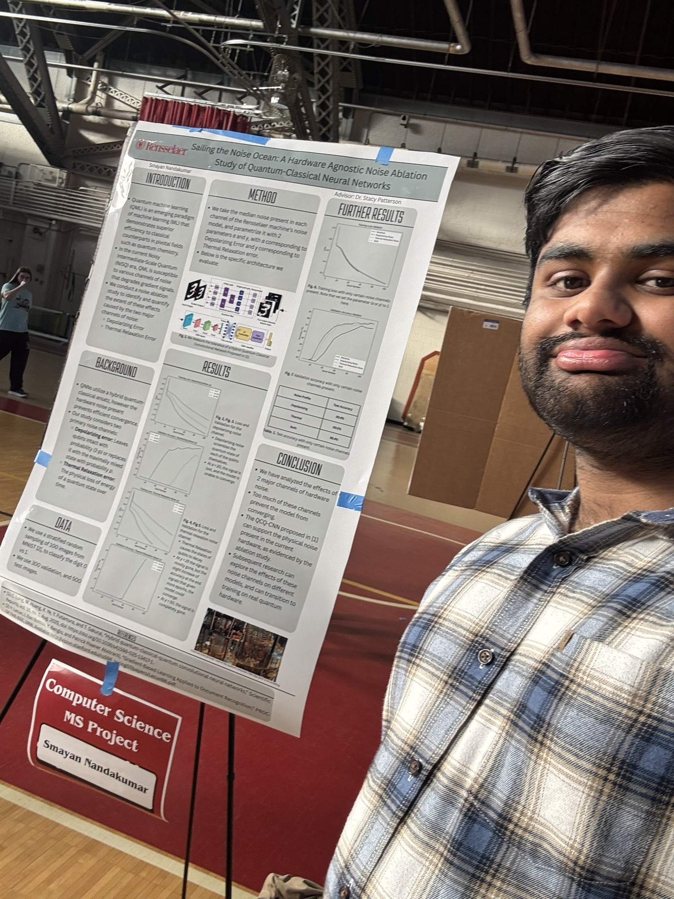

During my master's, I ran a noise ablation study to measure the effects of Depolarizing error and Thermal Relaxation error on a QCQ-CNN's (quantum-classical-quantum convolutional neural network) performance. I benchmarked it on simulation and on real IBM Quantum Hardware. 


